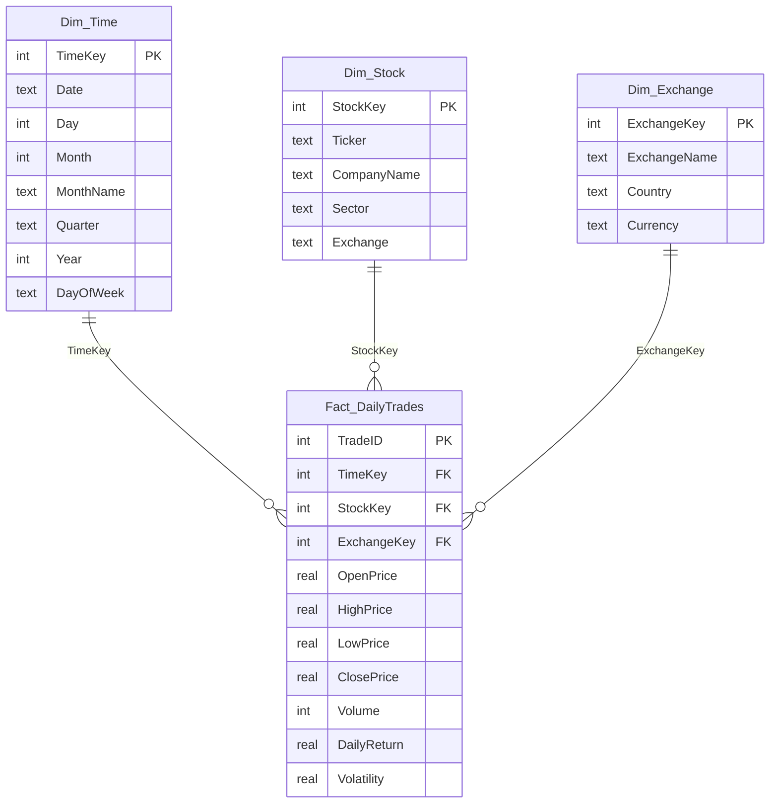

# Data Warehousing and Mining (DWM) — Experiments 01 & 02
## Experiment 01: Build Data Warehouse / Data Mart & Design Dimensional Data Models (Star, Snowflake, Fact Constellation)
## Experiment 02: Perform OLAP Operations on the Dimensional Model (Slice, Dice, Roll-Up, Drill-Down, Pivot, Drill-Across)

**Dataset:** `stock_market_data.csv` (`14,800` daily trading records across `20` NSE stocks and `5` sectors)  
**SQL Scripts:** [`lab1_schema.sql`](lab1_schema.sql) | [`lab2_olap.sql`](lab2_olap.sql) | **Execution Engine:** [`run_labs_1_2.py`](run_labs_1_2.py)

---

## Part 1 — Experiment 01: Dimensional Data Warehouse Modeling

### 1.1 Star Schema Architecture
A central denormalized fact table (`Fact_DailyTrades`) surrounded by single-join dimension tables (`Dim_Time`, `Dim_Stock`, `Dim_Exchange`).



### 1.2 Snowflake Schema Architecture
Normalizes `Dim_Stock` into `Dim_Stock_Snowflake` and `Dim_Sector` (`SectorKey` FK) to eliminate sector redundancy.

### 1.3 Fact Constellation (Galaxy) Schema Architecture
Two independent fact tables (`Fact_DailyTrades` for daily market microstructure and `Fact_QuarterlyFinancials` for corporate earnings fundamentals) sharing conformed dimensions (`Dim_Time`, `Dim_Stock`, `Dim_Exchange`).

### 1.4 Populated Data Warehouse Table Counts
| Table_Name | Schema_Role | Row_Count |
| --- | --- | --- |
| Dim_Time | Conformed Dimension (All Schemas) | 740 |
| Dim_Exchange | Conformed Dimension (All Schemas) | 1 |
| Dim_Stock | Star & Fact Constellation | 20 |
| Fact_DailyTrades | Star & Fact Constellation | 14800 |
| Dim_Sector | Snowflake Schema | 5 |
| Dim_Stock_Snowflake | Snowflake Schema | 20 |
| Fact_DailyTrades_Snowflake | Snowflake Schema | 14800 |
| Fact_QuarterlyFinancials | Fact Constellation (Galaxy Schema) | 260 |

---

## Part 2 — Experiment 02: OLAP Cube Operations & Query Outputs

### 1. SLICE OPERATION
**Objective:** Isolate trading performance for a single time slice (`Year = 2024 AND MonthName = 'January'`).

```sql
SELECT
    s.Ticker,
    s.Sector,
    COUNT(f.TradeID)           AS Trading_Days_Jan2024,
    ROUND(AVG(f.OpenPrice), 2) AS Avg_Open_Price,
    ROUND(AVG(f.ClosePrice), 2) AS Avg_Close_Price,
    SUM(f.Volume)              AS Total_Jan2024_Volume,
    ROUND(AVG(f.DailyReturn), 3) AS Avg_Daily_Return_Pct
FROM Fact_DailyTrades f
JOIN Dim_Time t  ON f.TimeKey  = t.TimeKey
JOIN Dim_Stock s ON f.StockKey = s.StockKey
WHERE t.Year = 2024
  AND t.MonthName = 'January'
GROUP BY s.Ticker, s.Sector
ORDER BY Total_Jan2024_Volume DESC
LIMIT 10;
```

**Query Output (10 rows):**

| Ticker | Sector | Trading_Days_Jan2024 | Avg_Open_Price | Avg_Close_Price | Total_Jan2024_Volume | Avg_Daily_Return_Pct |
| --- | --- | --- | --- | --- | --- | --- |
| HDFCBANK | Banking | 21 | 759.26 | 757.57 | 1196034334 | -0.195 |
| KOTAKBANK | Banking | 21 | 364.84 | 363.46 | 577145560 | -0.373 |
| ONGC | Energy | 21 | 199.78 | 200.49 | 544958210 | 0.392 |
| WIPRO | IT | 21 | 218.12 | 217.03 | 465438876 | -0.481 |
| ICICIBANK | Banking | 21 | 975.36 | 974.81 | 406073965 | -0.042 |
| NTPC | Energy | 21 | 292.97 | 291.7 | 401932243 | -0.421 |
| SBIN | Banking | 21 | 597.34 | 596.31 | 361863713 | -0.167 |
| POWERGRID | Energy | 21 | 220.79 | 221.9 | 361815390 | 0.509 |
| ITC | FMCG | 21 | 399.78 | 398.12 | 293673658 | -0.413 |
| RELIANCE | Energy | 21 | 1326.69 | 1331.94 | 258674746 | 0.412 |

### 2. DICE OPERATION
**Objective:** Extract a sub-cube across multiple dimensions (`Sector IN ('IT', 'Banking') AND Year = 2024 AND Quarter = 'Q1' AND ExchangeName = 'NSE'`).

```sql
SELECT
    s.Sector,
    s.Ticker,
    t.Year,
    t.Quarter,
    COUNT(f.TradeID)             AS Trading_Sessions,
    ROUND(AVG(f.ClosePrice), 2)  AS Avg_Close_Price,
    SUM(f.Volume)                AS SubCube_Total_Volume,
    ROUND(AVG(f.DailyReturn), 3) AS Avg_Daily_Return_Pct,
    ROUND(AVG(f.Volatility), 2)  AS Avg_Intraday_Volatility_Pct
FROM Fact_DailyTrades f
JOIN Dim_Time t     ON f.TimeKey     = t.TimeKey
JOIN Dim_Stock s    ON f.StockKey    = s.StockKey
JOIN Dim_Exchange e ON f.ExchangeKey = e.ExchangeKey
WHERE s.Sector IN ('IT', 'Banking')
  AND t.Year = 2024
  AND t.Quarter = 'Q1'
  AND e.ExchangeName = 'NSE'
GROUP BY s.Sector, s.Ticker, t.Year, t.Quarter
ORDER BY s.Sector, SubCube_Total_Volume DESC;
```

**Query Output (8 rows):**

| Sector | Ticker | Year | Quarter | Trading_Sessions | Avg_Close_Price | SubCube_Total_Volume | Avg_Daily_Return_Pct | Avg_Intraday_Volatility_Pct |
| --- | --- | --- | --- | --- | --- | --- | --- | --- |
| Banking | HDFCBANK | 2024 | Q1 | 60 | 710.6 | 3067957104 | 0.011 | 1.76 |
| Banking | KOTAKBANK | 2024 | Q1 | 60 | 353.33 | 1545427070 | -0.265 | 1.85 |
| Banking | SBIN | 2024 | Q1 | 60 | 662.44 | 1257671531 | 0.132 | 2.42 |
| Banking | ICICIBANK | 2024 | Q1 | 60 | 1011.44 | 1033167760 | 0.119 | 2.01 |
| IT | WIPRO | 2024 | Q1 | 60 | 229.05 | 1046812522 | -0.229 | 2.64 |
| IT | INFY | 2024 | Q1 | 60 | 1494.16 | 403397716 | -0.08 | 1.86 |
| IT | HCLTECH | 2024 | Q1 | 60 | 1435.22 | 181871272 | -0.087 | 2.36 |
| IT | TCS | 2024 | Q1 | 60 | 3646.28 | 148590646 | 0.02 | 1.95 |

### 3. ROLL-UP OPERATION
**Objective:** Aggregate daily stock metrics up the time hierarchy (`Day -> Month -> Year`) by Sector (`Year = 2025`).

```sql
SELECT
    t.Year,
    t.Month,
    t.MonthName,
    s.Sector,
    COUNT(f.TradeID)             AS Total_Stock_Days,
    SUM(f.Volume)                AS Monthly_Sector_Volume,
    ROUND(AVG(f.ClosePrice), 2)  AS Avg_Sector_Close_Price,
    ROUND(AVG(f.DailyReturn), 3) AS Avg_Daily_Return_Pct
FROM Fact_DailyTrades f
JOIN Dim_Time t  ON f.TimeKey  = t.TimeKey
JOIN Dim_Stock s ON f.StockKey = s.StockKey
WHERE t.Year = 2025
GROUP BY t.Year, t.Month, t.MonthName, s.Sector
ORDER BY t.Year, t.Month, Monthly_Sector_Volume DESC
LIMIT 15;
```

**Query Output (15 rows):**

| Year | Month | MonthName | Sector | Total_Stock_Days | Monthly_Sector_Volume | Avg_Sector_Close_Price | Avg_Daily_Return_Pct |
| --- | --- | --- | --- | --- | --- | --- | --- |
| 2025 | 1 | January | Banking | 92 | 1482865447 | 785.01 | -0.17 |
| 2025 | 1 | January | Energy | 92 | 1212977472 | 519.24 | -0.09 |
| 2025 | 1 | January | IT | 92 | 623106512 | 1919.86 | -0.133 |
| 2025 | 1 | January | FMCG | 92 | 457258442 | 2149.2 | 0.114 |
| 2025 | 1 | January | Auto | 92 | 422617711 | 5909.66 | 0.063 |
| 2025 | 2 | February | Banking | 80 | 1294152256 | 787.52 | -0.087 |
| 2025 | 2 | February | Energy | 80 | 951626430 | 502.94 | -0.283 |
| 2025 | 2 | February | IT | 80 | 411343881 | 1829.41 | -0.482 |
| 2025 | 2 | February | FMCG | 80 | 388754295 | 2125.98 | -0.524 |
| 2025 | 2 | February | Auto | 80 | 334536137 | 6079.67 | -0.536 |
| 2025 | 3 | March | Banking | 76 | 1301862099 | 804.12 | 0.339 |
| 2025 | 3 | March | Energy | 76 | 1092733430 | 511.34 | 0.316 |
| 2025 | 3 | March | IT | 76 | 478880914 | 1666.91 | 0.019 |
| 2025 | 3 | March | FMCG | 76 | 331863578 | 2060.41 | 0.207 |
| 2025 | 3 | March | Auto | 76 | 328810360 | 5534.86 | -0.058 |

### 4. DRILL-DOWN OPERATION
**Objective:** Navigate from high-level `Energy` Sector summary down to individual Stock Tickers and Quarters using the **Snowflake Schema** (`Dim_Sector -> Dim_Stock_Snowflake -> Fact_DailyTrades_Snowflake`).

```sql
SELECT
    sec.SectorName,
    sec.IndustryCategory,
    st.Ticker,
    t.Year,
    t.Quarter,
    COUNT(fs.TradeID)             AS Sessions,
    ROUND(AVG(fs.ClosePrice), 2)  AS Quarterly_Avg_Close,
    SUM(fs.Volume)                AS Quarterly_Volume,
    ROUND(AVG(fs.Volatility), 2)  AS Avg_Volatility_Pct
FROM Fact_DailyTrades_Snowflake fs
JOIN Dim_Stock_Snowflake st ON fs.StockKey  = st.StockKey
JOIN Dim_Sector sec         ON st.SectorKey = sec.SectorKey
JOIN Dim_Time t             ON fs.TimeKey   = t.TimeKey
WHERE sec.SectorName = 'Energy'
  AND t.Year = 2025
GROUP BY sec.SectorName, sec.IndustryCategory, st.Ticker, t.Year, t.Quarter
ORDER BY st.Ticker, t.Quarter;
```

**Query Output (16 rows):**

| SectorName | IndustryCategory | Ticker | Year | Quarter | Sessions | Quarterly_Avg_Close | Quarterly_Volume | Avg_Volatility_Pct |
| --- | --- | --- | --- | --- | --- | --- | --- | --- |
| Energy | Energy, Oil & Power Utilities | NTPC | 2025 | Q1 | 62 | 312.6 | 857369009 | 2.84 |
| Energy | Energy, Oil & Power Utilities | NTPC | 2025 | Q2 | 61 | 331.5 | 922873472 | 2.14 |
| Energy | Energy, Oil & Power Utilities | NTPC | 2025 | Q3 | 64 | 325.2 | 575230757 | 1.48 |
| Energy | Energy, Oil & Power Utilities | NTPC | 2025 | Q4 | 62 | 323.15 | 498580798 | 1.39 |
| Energy | Energy, Oil & Power Utilities | ONGC | 2025 | Q1 | 62 | 229.53 | 793546712 | 2.82 |
| Energy | Energy, Oil & Power Utilities | ONGC | 2025 | Q2 | 61 | 229.59 | 862518880 | 2.38 |
| Energy | Energy, Oil & Power Utilities | ONGC | 2025 | Q3 | 64 | 225.71 | 531416764 | 1.35 |
| Energy | Energy, Oil & Power Utilities | ONGC | 2025 | Q4 | 62 | 235.27 | 516481670 | 1.68 |
| Energy | Energy, Oil & Power Utilities | POWERGRID | 2025 | Q1 | 62 | 269.82 | 851814599 | 2.77 |
| Energy | Energy, Oil & Power Utilities | POWERGRID | 2025 | Q2 | 61 | 287.25 | 821158760 | 2.35 |
| Energy | Energy, Oil & Power Utilities | POWERGRID | 2025 | Q3 | 64 | 279.13 | 650675935 | 1.61 |
| Energy | Energy, Oil & Power Utilities | POWERGRID | 2025 | Q4 | 62 | 269.37 | 731658781 | 1.62 |
| Energy | Energy, Oil & Power Utilities | RELIANCE | 2025 | Q1 | 62 | 1234.29 | 754607012 | 1.82 |
| Energy | Energy, Oil & Power Utilities | RELIANCE | 2025 | Q2 | 61 | 1372.3 | 749398134 | 1.84 |
| Energy | Energy, Oil & Power Utilities | RELIANCE | 2025 | Q3 | 64 | 1407.23 | 649438952 | 1.44 |
| Energy | Energy, Oil & Power Utilities | RELIANCE | 2025 | Q4 | 62 | 1490.46 | 633826489 | 1.32 |

### 5. PIVOT (CROSS-TABULATION) OPERATION
**Objective:** Rotate dimensional axes to cross-tabulate `Sector` (rows) against `Quarter` (`Q1`–`Q4` columns) for Average Daily Return (%) and Traded Volume (Millions).

```sql
SELECT
    s.Sector,
    ROUND(AVG(CASE WHEN t.Quarter = 'Q1' THEN f.DailyReturn END), 4) AS Q1_Avg_Return_Pct,
    ROUND(AVG(CASE WHEN t.Quarter = 'Q2' THEN f.DailyReturn END), 4) AS Q2_Avg_Return_Pct,
    ROUND(AVG(CASE WHEN t.Quarter = 'Q3' THEN f.DailyReturn END), 4) AS Q3_Avg_Return_Pct,
    ROUND(AVG(CASE WHEN t.Quarter = 'Q4' THEN f.DailyReturn END), 4) AS Q4_Avg_Return_Pct,
    ROUND(SUM(CASE WHEN t.Quarter = 'Q1' THEN f.Volume ELSE 0 END) / 1e6, 2) AS Q1_Vol_Millions,
    ROUND(SUM(CASE WHEN t.Quarter = 'Q2' THEN f.Volume ELSE 0 END) / 1e6, 2) AS Q2_Vol_Millions,
    ROUND(SUM(CASE WHEN t.Quarter = 'Q3' THEN f.Volume ELSE 0 END) / 1e6, 2) AS Q3_Vol_Millions,
    ROUND(SUM(CASE WHEN t.Quarter = 'Q4' THEN f.Volume ELSE 0 END) / 1e6, 2) AS Q4_Vol_Millions
FROM Fact_DailyTrades f
JOIN Dim_Time t  ON f.TimeKey  = t.TimeKey
JOIN Dim_Stock s ON f.StockKey = s.StockKey
GROUP BY s.Sector
ORDER BY s.Sector;
```

**Query Output (5 rows):**

| Sector | Q1_Avg_Return_Pct | Q2_Avg_Return_Pct | Q3_Avg_Return_Pct | Q4_Avg_Return_Pct | Q1_Vol_Millions | Q2_Vol_Millions | Q3_Vol_Millions | Q4_Vol_Millions |
| --- | --- | --- | --- | --- | --- | --- | --- | --- |
| Auto | -0.065 | 0.0435 | -0.0676 | -0.1633 | 2946.21 | 3141.14 | 2770.08 | 3003.72 |
| Banking | -0.0173 | 0.1059 | -0.0187 | 0.0398 | 16169.27 | 17077.87 | 13728.27 | 13061.76 |
| Energy | 0.0542 | -0.117 | -0.1154 | -0.1251 | 11650.28 | 11380.79 | 9544.42 | 9034.73 |
| FMCG | -0.1679 | 0.0309 | -0.0624 | -0.11 | 4623.58 | 4235.61 | 3356.34 | 2930.37 |
| IT | -0.2184 | -0.066 | -0.0671 | 0.0712 | 5379.2 | 6613.73 | 5489.44 | 4331.91 |

### 6. DRILL-ACROSS OPERATION
**Objective:** Join two distinct Fact Tables (`Fact_DailyTrades` and `Fact_QuarterlyFinancials`) across conformed dimensions (`Dim_Stock`, `Dim_Time`) in the **Fact Constellation Schema**.

```sql
WITH Market_Annual AS (
    SELECT
        f.StockKey,
        t.Year AS TradeYear,
        SUM(f.Volume)                AS Annual_Traded_Volume,
        ROUND(AVG(f.ClosePrice), 2)  AS Annual_Avg_Share_Price,
        ROUND(AVG(f.Volatility), 2)  AS Annual_Intraday_Volatility
    FROM Fact_DailyTrades f
    JOIN Dim_Time t ON f.TimeKey = t.TimeKey
    WHERE t.Year = 2025
    GROUP BY f.StockKey, t.Year
),
Financials_Annual AS (
    SELECT
        qf.StockKey,
        qf.FiscalYear,
        ROUND(SUM(qf.QuarterlyRevenue), 2) AS Annual_Revenue_Cr,
        ROUND(SUM(qf.NetProfit), 2)        AS Annual_NetProfit_Cr,
        ROUND(AVG(qf.EPS), 2)              AS Avg_Quarterly_EPS,
        ROUND(AVG(qf.OperatingMargin), 2)  AS Avg_Operating_Margin_Pct
    FROM Fact_QuarterlyFinancials qf
    WHERE qf.FiscalYear = 2025
    GROUP BY qf.StockKey, qf.FiscalYear
)
SELECT
    s.Ticker,
    s.CompanyName,
    s.Sector,
    m.TradeYear                    AS Year,
    m.Annual_Avg_Share_Price       AS Avg_Price_INR,
    m.Annual_Traded_Volume         AS Total_Volume,
    fin.Annual_Revenue_Cr          AS Revenue_Cr,
    fin.Annual_NetProfit_Cr        AS NetProfit_Cr,
    fin.Avg_Quarterly_EPS          AS Avg_EPS_INR,
    fin.Avg_Operating_Margin_Pct   AS Op_Margin_Pct
FROM Market_Annual m
JOIN Financials_Annual fin ON m.StockKey = fin.StockKey AND m.TradeYear = fin.FiscalYear
JOIN Dim_Stock s           ON m.StockKey = s.StockKey
ORDER BY fin.Annual_NetProfit_Cr DESC
LIMIT 12;
```

**Query Output (12 rows):**

| Ticker | CompanyName | Sector | Year | Avg_Price_INR | Total_Volume | Revenue_Cr | NetProfit_Cr | Avg_EPS_INR | Op_Margin_Pct |
| --- | --- | --- | --- | --- | --- | --- | --- | --- | --- |
| RELIANCE | Reliance Industries Ltd. | Energy | 2025 | 1376.33 | 2787270587 | 1010804.62 | 157777.44 | 173.78 | 21.68 |
| ONGC | Oil and Natural Gas Corporation Ltd. | Energy | 2025 | 229.99 | 2703964026 | 583366.94 | 85670.94 | 68.44 | 20.42 |
| SBIN | State Bank of India | Banking | 2025 | 806.11 | 2620506214 | 476402.97 | 82555.29 | 79.88 | 24.14 |
| TATAMOTORS | Tata Motors Passenger Vehicles Ltd. | Auto | 2025 | 614.4 | 3309207651 | 460589.74 | 81076.49 | 69.04 | 24.45 |
| TCS | Tata Consultancy Services Ltd. | IT | 2025 | 3232.21 | 667864940 | 261076.68 | 48118.9 | 50.8 | 25.59 |
| HDFCBANK | HDFC Bank Ltd. | Banking | 2025 | 925.65 | 4980188247 | 330786.4 | 47503.38 | 47.96 | 19.92 |
| ICICIBANK | ICICI Bank Ltd. | Banking | 2025 | 1349.25 | 2585096181 | 239912.75 | 38348.14 | 43.54 | 22.23 |
| NTPC | NTPC Ltd. | Energy | 2025 | 323.09 | 2854054036 | 188588.46 | 32231.34 | 27.25 | 23.73 |
| INFY | Infosys Ltd. | IT | 2025 | 1535.84 | 1921000711 | 170604.16 | 26207.21 | 25.13 | 21.3 |
| MARUTI | Maruti Suzuki India Ltd. | Auto | 2025 | 13376.57 | 98048404 | 157834.12 | 26050.2 | 25.13 | 22.94 |
| M&M | Mahindra & Mahindra Ltd. | Auto | 2025 | 3156.57 | 653708140 | 146264.76 | 25262.89 | 22.55 | 23.99 |
| HCLTECH | HCL Technologies Ltd. | IT | 2025 | 1520.27 | 716372559 | 119780.3 | 20469.07 | 17.72 | 23.69 |
